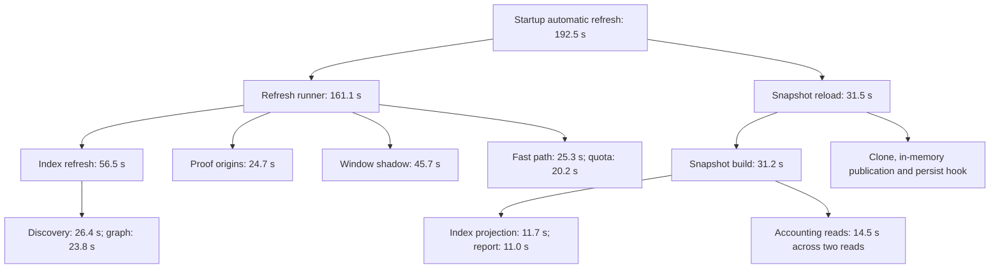

# Result and boundary

On Windows x64, unsigned candidate `2026110705` loaded the two source repairs
from `6263d0a79601e56e0e5427589fbd4a0247d0599e`. The owner authorized the
build, normal candidate switch and observation against the production profile,
then normally exited the previous candidate. The replacement's startup
automatic overview refresh succeeded in 192542.340 ms. No manual refresh was
sent. Its snapshot index projection contained report work and no
`projection_work`; the independent work view subsequently reported ready.

This receipt closes the exact-candidate loading and automatic live-publication
gates left open by the earlier
[reader/projection slice receipt](2026-11-07-local-refresh-performance-slices.md).
It records one cold-process app-driven refresh, not three matched full-refresh
runs, a whole-refresh speedup, sustained responsiveness, installed-app,
credential, signing, updater or release qualification. The repeated fixed-input
comparisons remain in the earlier slice receipt, including the 9.4% cold
origin-reader regression and 23.3% warm improvement. Neither result is hidden
by the snapshot improvement.

# Artifact and isolation evidence

- Product version: `0.1.27`; build: `2026110705`; target: `win32-x64`.
- Source: `6263d0a79601e56e0e5427589fbd4a0247d0599e`, clean at staging.
- ASAR SHA-256:
  `691afbfea9a31cad6ef1c4afa4b62663a83b5780969f09cde23f1e7c12467d04`.
- Candidate directory:
  `.release-build/live-refresh-performance-20261107/artifacts/win-unpacked`.
- Staging used the reviewed production entrypoint with Node `26.2.0`.
  Builder produced a directory candidate with signing disabled and publication
  set to never. The previous candidate and prior staging were preserved.
- Staged runtime verification and exact staged/archive file-set and byte
  comparison passed for 760 files, allowing only the reviewed builder manifest
  transform. Native bytes were included; this is not native qualification.
- An initial development-artifact verification call refused the production
  profile. It was not treated as a passing gate; the separate production
  staged/archive verification above supplied the byte evidence.

Before live activation, the actual packaged renderer was inspected with a
synthetic disposable profile. Synthetic usage was ingested, accounting and
snapshot construction completed, the native window rendered ready, and the
reviewed quit protocol exited it normally. Snapshot projection had no
`projection_work`. Quota remained honestly unavailable with
`app_server_unavailable` because that profile had no real app-server account.
The normal hosted smoke therefore did not pass; synthetic renderer/ingestion
evidence is narrower. No real credentials were copied into the test profile.

Native UI automation was unavailable. The owner exited the old candidate with
the normal quit action; absence of its process tree was verified before
launching the replacement. The live launch used the normal profile, without
`ELECTRON_RUN_AS_NODE` or `NODE_OPTIONS`; a loopback-only debug endpoint enabled
read-only renderer inspection. No forced process termination, installation,
settings edit, schema change, durable cache-format change, signing or
publication occurred.

# Automatic production refresh

Launch was observed at `2026-11-07T02:31:01.9393085Z`. The automatic refresh
began at `02:31:07.871Z` and completed at `02:34:20.412Z`, reason `startup`,
mode `overview`, terminal status `succeeded`, error code null. Launch to refresh
start was about 5.932 seconds; this is not a measured launch-to-ready time.
Cold means a fresh application process, not a cold Windows filesystem cache.

The watcher only polled the existing loopback refresh GET route. It matched one
refresh identity and saved allowlisted aggregate timing/accounting evidence.
No competing benchmark was run during the refresh. Ordinary application and
source-writer activity were not frozen, so comparison with any previous live
pass is observational. The earlier 366-second incident and a pre-switch
372.905-second pass had different workloads and cache states.

| Stage | Wall time, ms | Interpretation |
|---|---:|---|
| Complete automatic refresh | 192542.340 | Includes runner and snapshot reload |
| Refresh runner | 161085.492 | Nested refresh work before snapshot reload |
| Quota collection | 5916.238 | Separate collector activity |
| Index refresh | 56492.555 | Includes discovery, ingestion and maintenance |
| Index discovery | 26440.604 | Includes graph and file inspection |
| Discovery graph | 23766.850 | Residual graph cost; no graph optimization retained |
| Accounting proof origins | 24666.726 | First proof in a fresh process; not warm-cache evidence |
| Accounting window shadow | 45747.300 | Separate residual cost |
| Accounting fast path | 25316.833 | Includes quota and usage portions |
| Fast-path usage | 568.492 | Nested in fast path |
| Fast-path quota | 20177.610 | Nested in fast path |
| Snapshot reload | 31453.674 | Includes build, clone and publication path |
| Snapshot build | 31212.098 | Contains projection and accounting reads |
| Snapshot accounting reads | 14463.952 | Aggregate of two reads; initial read overlaps projection |
| Snapshot index projection | 11717.135 | Companion/report only |
| Report projection | 11011.125 | Nested in snapshot index projection |
| Work projection | Not invoked | No `projection_work` in this refresh snapshot |
| Collector projection | 1956.367 | Snapshot composition |
| Snapshot clone | 240.618 | In-memory publication preparation |
| Snapshot persist hook | 0.070 | Hook duration; does not prove a disk write or fsync |

Times are nested or overlapping and must not be summed. There is no independent
snapshot-publish timer: reload completion plus the subsequent ready snapshot
and new overview prove publication, not a separately isolated publish cost.
The persist hook can return without writing and is not storage durability
evidence.

The observed critical path is:

This diagram shows containment and the main publication path; sibling costs
can overlap. Independent work reports are outside the dashboard snapshot path
and still run through the existing query service and freshness/lease checks.

# Correctness and rendered-state checks

The pass indexed 4,368 sources, rescanned two sources and scanned 47,184,011
bytes. Published generation was `25061`; accounting reported `replay_safe`,
`fast_path`, complete accounting coverage, generation matched and fallback
count zero. Window counters were dirty 1, recomputed 1, unavailable 0,
mismatch 0 and full rebuilds 0. No account-attribution change was made.

Generation status remained partial because tool provenance was incomplete.
Tool output stayed unavailable with `typed_tool_history_partial`; this was
not promoted to complete tool coverage. Accounting proof recorded six unknown
origins with usage; those remained unknown. A successful refresh does not mean
every recoverable timing subspan had zero refusals.

At `2026-11-07T02:36:29.093Z`, read-only GET/renderer inspection showed:

- health ready; snapshot ready with no snapshot error;
- overview live, evidence available, collector available and quota available;
- accounting windows/timeline/quota exact at `02:32:37.116Z`, with calibration,
  weekly intervals and plan scope explicitly retained at their own timestamps;
- accounting generation `25061`, matched, fallback zero, cache available;
- quota phase published and usage phase succeeded;
- content-free privacy projection: raw logs, account identifiers and local
  paths excluded, remote upload disabled;
- packaged renderer ready, overview heading visible, refresh button enabled,
  width 1,170 CSS pixels, no alert dialog and no current timeout text.

These are point-in-time checks. Freshness values belong to the returned
snapshot and do not assert that its evidence timestamp advances continuously.
At `02:37:05.245Z`, the independent work view had ready status and ready body
state, its error element was hidden and its diagnostic code absent. The view
was inactive; no page navigation, new work query or manual refresh was sent by
the inspection. This proves retained functionality after the split, not
sustained timeout absence or performance of every reporting period.

# Remaining gates and rollback

Source-suite results and the three reproduced pre-existing broader failures
remain in the slice receipt. The complete repository suite, normal isolated
hosted smoke, native credential/path qualification, installer, signing and
publication gates are not claimed here.

The next measurements should isolate graph dependency reads, two snapshot
accounting reads, shadow/quota work and control-route latency during natural
refresh. A new matched three-run matrix is required before claiming a total
refresh speedup or a recurring-timeout fix. No extra timeout increase,
security-check bypass, work-usage disabling, unknown-to-zero conversion,
reintroduced account attribution or direct live-profile edit is an accepted
shortcut.

Rollback requires a normal quit and launch of the preserved prior candidate,
with its exact identity verified first. Neither repair changes schema or
durable cache format, so no data rollback, deletion or migration is required.
No rollback was performed during this observation.
